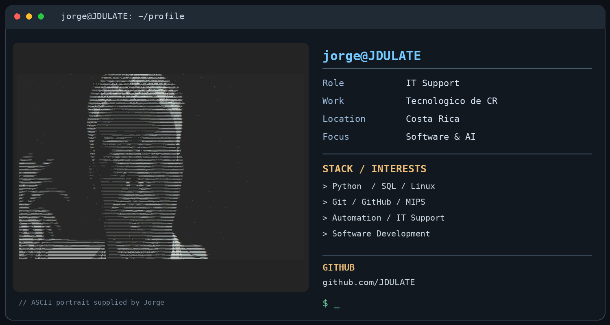

# Hola, soy Jorge Ulate 👋

**Software Development · IT Support · Artificial Intelligence**

### Sobre mí

Trabajo en soporte de TI en el **Tecnológico de Costa Rica** y me interesan el desarrollo de software, la automatización y la inteligencia artificial.

### Tecnologías y áreas

`Python` · `SQL` · `Git` · `GitHub` · `Linux` · `MIPS` · `Automatización` · `Soporte TI`

### Proyectos

Puedes explorar mis repositorios en [GitHub / JDULATE](https://github.com/JDULATE?tab=repositories).

---
